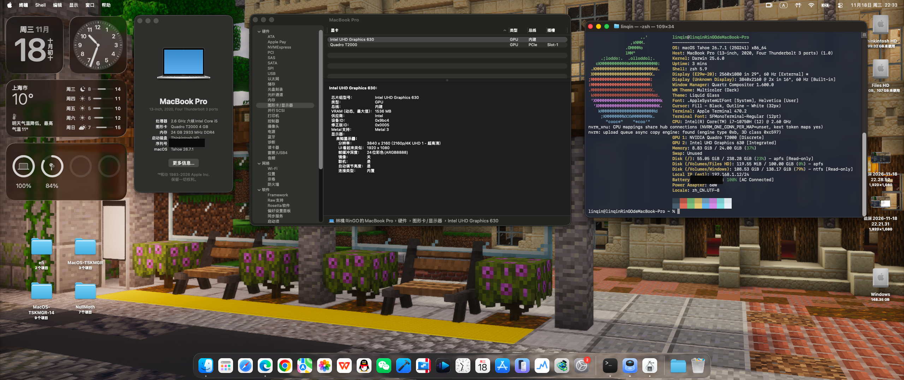
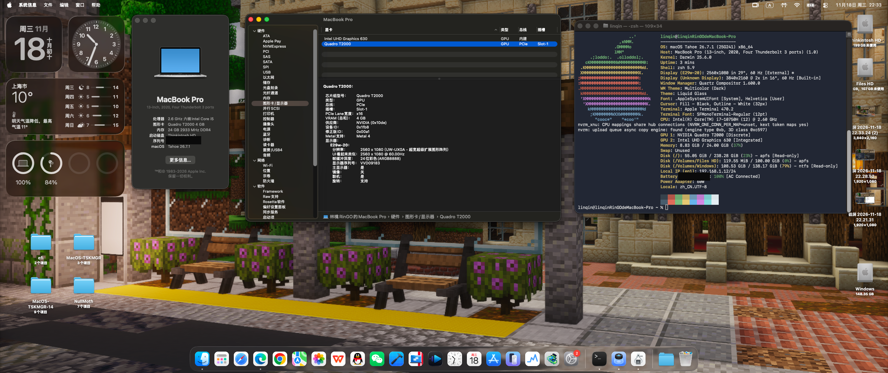

# ThinkPad P15 Hackintosh Tahoe EFI

适用于 **ThinkPad P15 Gen 1（20ST）**，搭载 Intel 十代移动平台、Intel UHD Graphics 630 + NVIDIA Quadro T2000 的笔记本 Hackintosh EFI。

本 EFI 基于 OpenCore，当前在 **macOS Tahoe 26.7.1（25G241）** 下运行。测试机采用 i7-10750H、24 GB DDR4 内存，并使用 MacBookPro16,2 SMBIOS。EFI 已完成日常使用所需的硬件适配，目前驱动和功能状态稳定。

> 本仓库只适用于硬件配置相近的设备。请先确认自己的硬件、BIOS 设置和 ACPI 设备名称，再修改 EFI；不要直接覆盖原有 EFI。

## 硬件信息

| 项目 | 配置 |
| --- | --- |
| 机型 | ThinkPad P15 Gen 1（20ST） |
| CPU | Intel Core i7-10750H，6 核 12 线程，2.6 GHz |
| 核显 | Intel UHD Graphics 630，Metal 可用，动态显存最高约 1536 MB |
| 独显 | NVIDIA Quadro T2000，4 GB，PCIe x16 |
| 内存 | 24 GB DDR4 |
| 无线网络 | Intel 无线网卡（AirportItlwm） |
| 有线网络 | Intel 千兆网卡（IntelMausiEthernet） |
| 触控板 | RMI/SMBus 触控板方案 |
| 系统 | macOS Tahoe 26.7.1（Darwin 25.6.0） |
| 引导 | OpenCore |
| SMBIOS | MacBookPro16,2 |

## 当前功能状态

### 已工作

- ✅ 睡眠与唤醒
- ✅ 自动关闭显示器
- ✅ Intel Wi-Fi
- ✅ 有线网络
- ✅ Intel UHD 630 核显硬件加速
- ✅ NVIDIA Quadro T2000 独显（NullMoth）
- ✅ 内置音频
- ✅ 键盘与触控板
- ✅ 亮度调节与亮度快捷键
- ✅ 电池状态与电源管理
- ✅ USB 端口映射
- ✅ 蓝牙
- ✅ NVMe 存储

### 未工作

- ❌ AirDrop
- ❌ iPhone 镜像（iPhone Mirroring）

以上项目均为当前测试结果；不同 BIOS 版本、屏幕、无线网卡和外设可能需要额外调整。本文配置针对 ThinkPad P15 Gen 1（20ST）整理。

## 混合显卡工作方式

这台机器采用混合显示模式：

- **Intel UHD Graphics 630** 负责内置屏幕和日常桌面显示，提供完整的核显硬件加速与亮度控制。
- **NVIDIA Quadro T2000** 通过 **NullMoth** 方案启用，在需要独显性能或连接外接显示器时提供图形输出/加速。
- macOS 可以同时识别两块 GPU；应用可根据显示器连接和性能需求使用对应 GPU。

从截图可以看到，内置屏幕挂在 Intel UHD 630 上，外接显示器由 Quadro T2000 提供输出。两块 GPU 可以同时工作，这是本 EFI 的核心适配点。

### 核显与内置屏幕



### 独显与外接显示器



## EFI 目录说明

```text
efi/
├── BOOT/
│   └── BOOTx64.efi
└── oc/
    ├── ACPI/       # 电源、背光、EC、USB 等 SSDT
    ├── Drivers/    # OpenCore 启动驱动
    ├── Kexts/      # 网络、蓝牙、显卡、触控板、传感器等 Kext
    ├── Resources/  # OpenCanopy 主题资源
    ├── Tools/
    │   └── NullMothSafe.efi
    ├── OpenCore.efi
    └── config.plist
```

### 主要组件

- `WhateverGreen.kext`：核显 framebuffer、显示输出和图形修复
- `AirportItlwm.kext`：Intel Wi-Fi
- `IntelMausiEthernet.kext`：Intel 有线网卡
- `IntelBluetoothFirmware.kext`、`BlueToolFixup.kext`：Intel 蓝牙
- `VoodooPS2Controller.kext`、`VoodooRMI.kext`、`VoodooSMBus.kext`：键盘与触控板
- `YogaSMC.kext`、`SMCBatteryManager.kext`、`SMCLightSensor.kext`：电池、传感器和机身功能
- `USBToolBox.kext` + `UTBMap.kext`：USB 定制端口映射
- `NVMeFix.kext`：NVMe 兼容性与电源管理
- `AMFIPass.kext`、`RestrictEvents.kext`：系统补丁与事件修复
- `NullMothSafe.efi`：独显 NullMoth 启动支持组件

## 使用方法

1. 使用 U 盘或其他方式备份当前 EFI。
2. 将本仓库中的 `efi` 文件夹复制到 EFI 分区根目录，确保路径为 `EFI/BOOT` 和 `EFI/OC`。
3. 使用 ProperTree、OCAuxiliaryTools 或 OpenCore Configurator 检查 `config.plist`。
4. 根据自己的硬件修改 SMBIOS、序列号、ROM、USB 映射和声卡布局；不要直接使用仓库中的身份信息。
5. 重启后在 BIOS/UEFI 中选择 OpenCore 启动项。
6. 首次更换 EFI 后建议执行一次 NVRAM 重置，再进入系统检查睡眠、亮度、网络、音频和外接显示器。

## BIOS 建议

不同主板名称可能略有差异，通常建议：

- 关闭 Secure Boot
- 关闭 Fast Boot
- 关闭 CSM/Legacy Boot，使用 UEFI 启动
- 按设备实际情况关闭 CFG-Lock
- 保持 SATA 控制器为 AHCI
- 混合显卡设备不要在 BIOS 中强制关闭核显

## 注意事项

- Quadro T2000 的 macOS 支持依赖 NullMoth 方案，系统更新后可能需要同步更新 NullMoth 组件和启动参数。
- `config.plist` 中包含本机专用的 SMBIOS 配置；发布或移植到其他设备前请重新生成身份信息。
- 无线网卡、触控板、声卡和 USB 控制器存在机型差异，功能正常不代表可直接移植到所有 P15 设备。
- 升级 macOS 前请先备份可启动的 EFI，并确认 OpenCore、Lilu、WhateverGreen、AirportItlwm 及 NullMoth 组件兼容目标系统。

## 致谢

感谢 OpenCore、Acidanthera、Lilu、WhateverGreen、AirportItlwm、Voodoo 系列及 NullMoth 项目维护者。

## 免责声明

本 EFI 仅供学习、研究和个人测试使用。使用前请自行备份数据并承担由此产生的风险。
